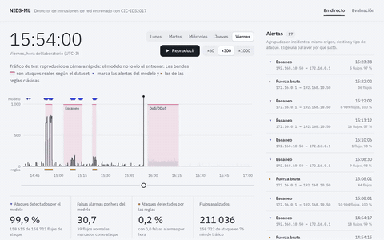
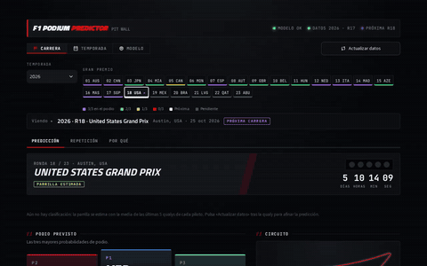
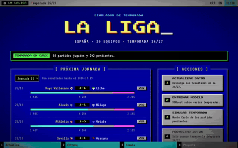

Computer Science & Engineering student at the **University of Granada**, 
specializing in **Computation and Intelligent Systems**. 
I build machine learning systems and measure them honestly: against the obvious baseline, not just accuracy.

 

> [!TIP]
> **Open to work, available now.** Remote, or on-site / hybrid in Granada (Spain).
> Looking for roles in **AI / machine learning development** or **cybersecurity**.

## Featured projects

<table>
  <tr>
    <td align="center" width="50%">
      
       <b><a href="https://github.com/juakincruzz/nids-ml">Network intrusion detector</a></b>
       LightGBM on CIC-IDS2017. Catches 99.6% of known-attack flows at ~10 false alarms per hour, and openly measures that it misses almost every unseen attack. Live dashboard with SHAP explanations.
    </td>
    <td align="center" width="50%">
      
       <b><a href="https://github.com/juakincruzz/f1-predictor">F1 Podium Predictor</a></b>
       XGBoost with data since 2010. Walk-forward 2023–2025: 2.01 of 3 podium drivers, vs 2.06 just copying the starting grid. Streamlit dashboard with SHAP and race replays.
    </td>
  </tr>
  <tr>
    <td align="center" width="50%">
      
       <b><a href="https://github.com/juakincruzz/LM_LaLiga">La Liga predictor</a></b>
       MS-DOS styled web app: XGBoost predicts every match and Monte Carlo simulates the season. ~53% accuracy on unseen matches, vs 55% for bookmakers.
    </td>
    <td align="center" width="50%">
      <a href="https://github.com/juakincruzz/tfg-segmentacion-dental-3d">
        <picture>
          <source media="(prefers-color-scheme: dark)" srcset="assets/tfg-dark.gif">
          
        </picture>
      </a>
       <b><a href="https://github.com/juakincruzz/tfg-segmentacion-dental-3d">3D dental segmentation</a></b> · <i>in progress</i>
       Bachelor's thesis: deep learning to segment and number every tooth (FDI) in 3D intraoral scans, with clinical and forensic uses. Defense in June 2027. <i>The animation is an illustration, not model output.</i>
    </td>
  </tr>
</table>

<b>More projects</b>

 

| Project | What it is | Stack |
|---|---|---|
| [IA_P3](https://github.com/juakincruzz/IA_P3) | Game-playing agent with Minimax, alpha-beta pruning and custom heuristics. Won all 8 evaluation games. **10/10** | C++17 |
| [AA](https://github.com/juakincruzz/AA) | CNNs on Fashion-MNIST, autoencoders, clustering and a Q-Learning agent. Deep learning assignment: **10/10** | TensorFlow, scikit-learn, Gymnasium |
| [IA_P2](https://github.com/juakincruzz/IA_P2) | Reactive and deliberative agents that explore, plan routes and cooperate. **9.55/10** | C++ |
| [TSI](https://github.com/juakincruzz/TSI) | Heuristic search (A*) for game agents, constraint programming and automated planning | Java, MiniZinc, PDDL |
| [IC](https://github.com/juakincruzz/IC) | Rule-based expert systems, OWL ontologies, fuzzy and probabilistic reasoning | CLIPS, OWL |
| [PDOO](https://github.com/juakincruzz/PDOO) | Object-oriented programming practices | Java, Ruby |
| [IG](https://github.com/juakincruzz/IG) | Computer graphics practices with shaders | Godot, GDScript |

## Experience

**Full-stack developer intern** · ATISoluciones Seguridad, Granada · *Jul – Sep 2026* 
Built an e-learning module for the company ERP from scratch (now in production), redesigned its news board and notifications, and finished a public-tender module with nightly ingestion and LLM-based scoring with validated output.

## Tech stack

 

Also: XGBoost · LightGBM · SHAP · pandas · NumPy · PyTorch Geometric · HTMX · Streamlit · MiniZinc · PDDL · TCP/IP

## Certifications & languages

- **Claude Code 101** and **Claude Code in Action** · Anthropic, 2026 · [verify](https://verify.skilljar.com/c/mdbmrgimebsr) · [verify](https://verify.skilljar.com/c/k9bet8dt99rj)
- **Cybersecurity Fundamentals** · IBM SkillsBuild · [verify on Credly](https://www.credly.com/badges/2df23474-fd8e-4003-9394-07d6ac49452a/public_url)
- **B2 First** · Cambridge English, 2021 · C1 in speaking

Spanish (native) · English (B2) · German (B1)

## GitHub activity

<picture>
  <source media="(prefers-color-scheme: dark)" srcset="https://github-readme-stats.vercel.app/api?username=juakincruzz&show_icons=true&hide_rank=true&hide=stars%2Cissues%2Ccontribs&hide_border=true&theme=github_dark&bg_color=00000000&title_color=2F81F7&icon_color=2F81F7">
  
</picture>
<picture>
  <source media="(prefers-color-scheme: dark)" srcset="https://github-readme-stats.vercel.app/api/top-langs/?username=juakincruzz&layout=compact&hide_border=true&theme=github_dark&bg_color=00000000&title_color=2F81F7&langs_count=8">
  
</picture>

<picture>
  <source media="(prefers-color-scheme: dark)" srcset="https://raw.githubusercontent.com/juakincruzz/juakincruzz/output/github-snake-dark.svg">
  
</picture>

More about me, my projects and a small hidden challenge at <a href="https://joaquinjcl.dev">joaquinjcl.dev</a>

